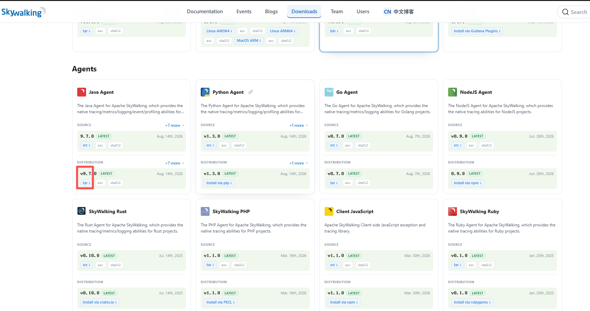
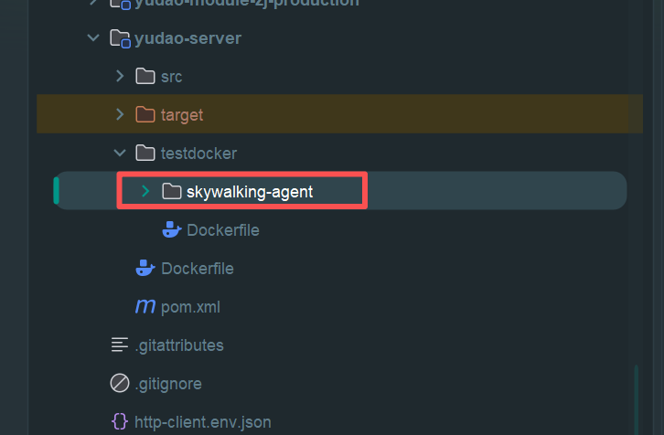

# skywalking安装

## 用docker部署

```yaml
services:

  banyandb:
    image: swr.cn-north-4.myhuaweicloud.com/ddn-k8s/docker.io/apache/skywalking-banyandb:0.11.0
    container_name: banyandb
    restart: always

    command: standalone

    ports:
      - "17912:17912"
      - "17913:17913"

    volumes:
      - ./banyandb-data:/data


  oap:
    image: swr.cn-north-4.myhuaweicloud.com/ddn-k8s/docker.io/apache/skywalking-oap-server:11.0.0
    container_name: skywalking-oap
    restart: always

    depends_on:
      - banyandb

    ports:
      - "11800:11800"
      - "12800:12800"
      - "17128:17128"
      - "17129:17129"
      - "9412:9412"

    environment:
      SW_STORAGE: banyandb
      SW_STORAGE_BANYANDB_TARGETS: banyandb:17912
      SW_RECEIVER_ZIPKIN: default
      SW_QUERY_ZIPKIN: default #启用 Zipkin Query


  ui:
    image: swr.cn-north-4.myhuaweicloud.com/ddn-k8s/docker.io/apache/skywalking-ui:horizon-1.0.0
    container_name: skywalking-ui
    restart: always

    depends_on:
      - oap

    ports:
      - "8088:8081"

    environment:
      HORIZON_OAP_QUERY_URL: http://oap:12800
      HORIZON_OAP_ADMIN_URL: http://oap:17128
      HORIZON_OAP_ZIPKIN_URL: http://oap:9412/zipkin
      HORIZON_AUTH_BACKEND: local
      HORIZON_AUTH_LOCAL_USERS: '[{"username":"admin","passwordHash":"$$argon2id$$v=19$$m=65536,t=3,p=4$$fg9x2VoP8IM4Is82Sw$$z49gHXL33o+Xd5R4NpFWlS4gXxQuLXwXJun/IVuujhA","roles":["admin"]}]'

```

## 官网：https://skywalking.apache.org/downloads/

### 下载Java Agent  https://www.apache.org/dyn/closer.cgi/skywalking/java-agent/9.7.0/apache-skywalking-java-agent-9.7.0.tgz



### 下载前端代码生成密钥
https://github.com/apache/skywalking-horizon-ui

### 生成命令
```sh
pnpm --filter bff cli:hash 123456
```
## 将apache-skywalking-java-agent放到项目中

> 要把整个文件夹放进去

## 打包镜像
```dockerfile
FROM swr.cn-north-4.myhuaweicloud.com/ddn-k8s/docker.io/eclipse-temurin:8-jre

# 创建业务用户
RUN useradd -u 2000 -m admin

# 创建目录
RUN mkdir -p \
    /yudao-server/csvfile \
    /src \
    /dest \
    /skywalking

# 设置目录权限
RUN chown -R root:root /yudao-server \
 && chown -R admin:admin /src /dest /skywalking \
 && chmod 755 /yudao-server \
 && chmod 755 /yudao-server/csvfile \
 && chmod 755 /src /dest \
 && chmod 755 /skywalking

WORKDIR /yudao-server

# MES 程序
COPY yudao-server.jar app.jar

# SkyWalking Agent
COPY --chown=admin:admin skywalking-agent/ /skywalking/agent/

# 切换为业务用户
USER admin

ENV TZ=Asia/Shanghai \
    JAVA_OPTS="-Xms2048m -Xmx2048m"

EXPOSE 48080

CMD exec java ${JAVA_OPTS} \
    -javaagent:/skywalking/agent/skywalking-agent.jar \
    -Djava.security.egd=file:/dev/./urandom \
    -jar app.jar
```
## 启动文件
```sh
horbar_addr=$1  # 地址
horbar_hzwxtest=$2  # 仓库名称
project=$3      # 工程名称

imageName=$horbar_addr/$horbar_hzwxtest/$project

echo "镜像名称：$imageName"

# 查找容器
containerId=$(docker ps -aq -f "name=^/${project}$")

echo "容器ID：$containerId"

# 删除旧容器
if [ -n "$containerId" ]; then
    docker stop "$containerId"
    docker rm "$containerId"
    echo "容器删除成功！！"
fi

# 删除旧镜像
docker rmi -f "$imageName" 2>/dev/null || true
echo "旧镜像删除完成"

# 登录镜像仓库
docker login -u admin -p '62352744AA??aa' "$horbar_addr"

if [ $? -ne 0 ]; then
    echo "镜像仓库登录失败！！"
    exit 1
fi

echo "登录成功！！"

# 拉取新镜像
docker pull "$imageName"

if [ $? -ne 0 ]; then
    echo "镜像拉取失败！！"
    exit 1
fi

echo "镜像拉取成功！！"

echo "开始启动 $project 容器"

docker run -d \
    --name "$project" \
    --restart=always \
    -p 48080:48080 \
    -p 9111:9111 \
    -e SPRING_PROFILES_ACTIVE=local \
    \
    -e SW_AGENT_NAME="${project}" \
    -e SW_AGENT_NAMESPACE="mes-test" \
    -e SW_AGENT_COLLECTOR_BACKEND_SERVICES="192.168.1.171:11800" \
    -e SW_LOGGING_LEVEL="WARN" \
    \
    -v /root/work/projects/yudao-server:/root/logs/ \
    -v /home/share:/yudao-server/csvfile \
    -v /home/share1:/yudao-server/src \
    -v /home/share2:/yudao-server/dest \
    "$imageName"

if [ $? -eq 0 ]; then
    echo "容器启动成功！！"
else
    echo "容器启动失败！！"
    exit 1
fi

echo "正在启动 $project 容器中..."
```

