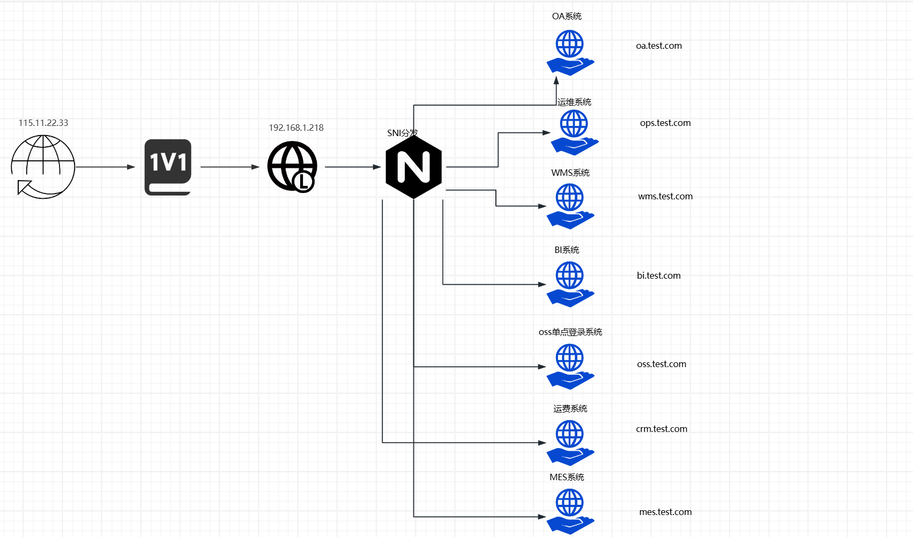

# Nginx 的 stream 模块配合 ssl_preread

> (解决外网IP太少的问题)

## docker-compose.yml安装脚本

```yaml
services:
  nginx:
    image: swr.cn-north-4.myhuaweicloud.com/ddn-k8s/docker.io/nginx:1.30.5-alpine-slim
    container_name: nginx
    restart: always
    ports:
      - "80:80"
      - "443:443"
    environment:
      - TZ=Asia/Shanghai
    volumes:
      - ./nginx.conf:/etc/nginx/nginx.conf
      - ./conf.d:/etc/nginx/conf.d
      - ./stream.d:/etc/nginx/stream.d
      - ./logs:/var/log/nginx
      - ./cert:/etc/nginx/cert
      - ./html:/usr/share/nginx/html
```

## sni配置，sni.conf配置文件

```conf
map $ssl_preread_server_name $backend {
    toa.test.com       backend_a;
    ops.test.com       backend_b;
    default     backend_a;
}

upstream backend_a {
    server 192.168.1.148:443;
}

upstream backend_b {
    server 192.168.1.215:443;
}

server {
    listen 443;
    proxy_pass $backend;
    ssl_preread on;
}
```

> nginx服务中心只做分发不做解析，不需要在服务中心添加ssl证书

## 外网DNS解析

一个外网IP解析多个域名

## 防火墙或者路由器，配置映射

 ```sh
 nat server protocol tcp global 115.233.222.222 443 inside 192.168.1.218 443 rule ServerRule_32
 ```
## 架构图片

