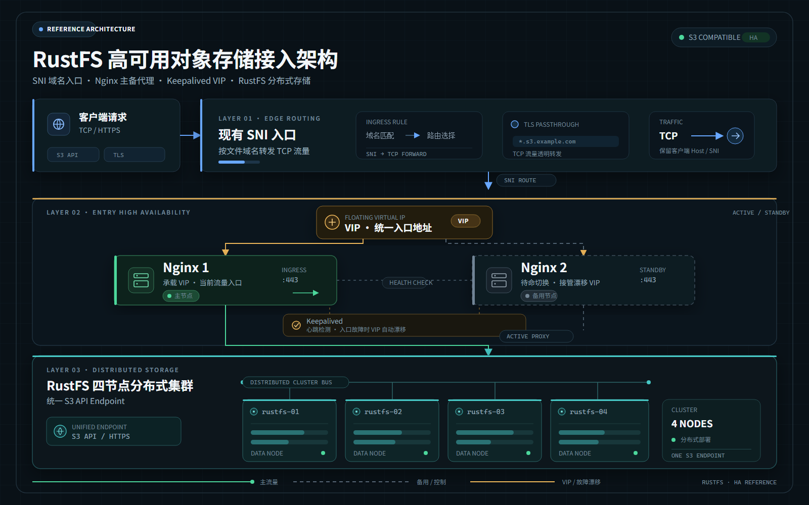

# rustfs高可用部署

## 架构图



## 安装NGINX

```yaml
services:
  nginx:
    image: swr.cn-north-4.myhuaweicloud.com/ddn-k8s/docker.io/nginx:1.31-alpine
    container_name: wms-file-nginx
    restart: unless-stopped
    ports:
      - "80:80"
      - "443:443"
    volumes:
      - ./nginx.conf:/etc/nginx/nginx.conf:ro
      - ./conf.d:/etc/nginx/conf.d:ro
      - ./certs:/etc/nginx/certs:ro
      - ./logs:/var/log/nginx
    healthcheck:
      test: ["CMD", "nginx", "-t"]
      interval: 30s
      timeout: 5s
      retries: 3
```

### 配置nginx.conf

```conf
worker_processes auto;

events {
    worker_connections 4096;
}

http {
    include       /etc/nginx/mime.types;
    default_type  application/octet-stream;

    sendfile on;
    keepalive_timeout 65;

    include /etc/nginx/conf.d/*.conf;
}
```


## 安装Keepalived

```sh
sudo apt-get update
sudo apt-get install -y keepalived curl

keepalived --version
sudo systemctl enable keepalived
```

### 主节点 A 配置

```sh
sudo cp /etc/keepalived/keepalived.conf.sample \
  /etc/keepalived/keepalived.conf.sample.bak 2>/dev/null || true
  
  # 重写名字
  sudo mv keepalived.conf.sample keepalived.conf
```

### 检测NGINX健康脚本

```sh
#!/usr/bin/env bash
set -eu

CONTAINER="wms-file-nginx"

# 1. Docker 容器必须处于运行状态
RUNNING="$(docker inspect -f '{{.State.Running}}' "$CONTAINER" 2>/dev/null || true)"
[ "$RUNNING" = "true" ] || exit 1

# 2. Nginx 配置必须通过检查
docker exec "$CONTAINER" nginx -t >/dev/null 2>&1 || exit 1

# 3. 宿主机的 443 端口必须能建立 TCP 连接
timeout 2 bash -c '</dev/tcp/127.0.0.1/443' >/dev/null 2>&1 || exit 1

exit 0
```

### 节点A配置

```sh
global_defs {
    router_id NGINX_NODE_A
    enable_script_security
    script_user root
}

# 检查本机 Docker Nginx 是否正常
vrrp_script chk_nginx {
    script "/usr/local/sbin/check-nginx-ha.sh"
    interval 2
    timeout 3
    fall 2
    rise 2
    weight 0
}

vrrp_instance VI_NGINX {
    state BACKUP
    interface ens3
    virtual_router_id 51
    priority 150
    advert_int 1
    version 3

    # 主节点实际 IP
    unicast_src_ip 192.168.1.56

    # 备节点实际 IP
    unicast_peer {
        192.168.1.57
    }
    # 漂移IP
    virtual_ipaddress {
        192.168.1.53/24 dev ens3
    }

    track_interface {
        ens3
    }

    track_script {
        chk_nginx
    }
}
```

### 节点B配置

```sh
global_defs {
    router_id NGINX_NODE_B
    enable_script_security
    script_user root
}

vrrp_script chk_nginx {
    script "/usr/local/sbin/check-nginx-ha.sh"
    interval 2
    timeout 3
    fall 2
    rise 2
    weight 0
}

vrrp_instance VI_NGINX {
    state BACKUP
    interface ens3
    virtual_router_id 51
    priority 100
    advert_int 1
    version 3

    # 备用节点自己的实际 IP
    unicast_src_ip 192.168.1.57

    # 主节点的实际 IP
    unicast_peer {
        192.168.1.56
    }

    # 与主节点完全一致
    virtual_ipaddress {
        192.168.1.53/24 dev ens3
    }

    track_interface {
        ens3
    }

    track_script {
        chk_nginx
    }
}
```


## 两台服务器分别执行

```sh
# 1. 查看 IP 和网卡名称
ip -br addr

# 2. 查看默认网关
ip route

# 3. 查看 Keepalived 状态
sudo systemctl status keepalived --no-pager

# 4. 查看 Nginx 容器
sudo docker ps

# 5. 查看 Nginx 配置是否正确
sudo docker exec nginx-ha nginx -t
```

## 启动keepalived

### 先启动备用节点

```sh
sudo systemctl enable keepalived
sudo systemctl restart keepalived
sudo systemctl status keepalived --no-pager
```

### 再启动主节点

```sh
sudo systemctl enable keepalived
sudo systemctl restart keepalived
sudo systemctl status keepalived --no-pager
```

### 查看漂移是否成功

```sh
ip addr show dev ens3
```

## 创建独立的数据盘

### 1. 创建卷组

```
sudo vgcreate vg_rustfs /dev/vdb
```

如果成功，应该能看到类似：

```
Volume group "vg_rustfs" successfully created
```

### 2. 创建逻辑卷

```
sudo lvcreate -n lv_rustfs -l 100%FREE vg_rustfs
```

### 3. 创建 XFS 文件系统

这一步会格式化新建的逻辑卷，请确认路径准确：

```
sudo mkfs.xfs -i size=512 -n ftype=1 /dev/vg_rustfs/lv_rustfs
```

### 4. 挂载数据目录

```
sudo mkdir -p /data/rustfs0
sudo mount /dev/vg_rustfs/lv_rustfs /data/rustfs0
```

检查挂载结果：

```
df -hT /data/rustfs0
sudo lvs
```

### 5. 设置开机自动挂载

使用 UUID 配置 `sudo vim /etc/fstab`，避免依赖设备名称：

```
UUID=$(sudo blkid -s UUID -o value /dev/vg_rustfs/lv_rustfs)

echo "UUID=$UUID /data/rustfs0 xfs defaults 0 2" \
  | sudo tee -a /etc/fstab
```

验证配置：

```
sudo mount -a
findmnt /data/rustfs0
df -hT /data/rustfs0
```

### 查看逻辑卷uuid

```sh
sudo blkid /dev/vg_rustfs/lv_rustfs
```

### 添加  

```sh
# 4b525e72-8446-48d5-862b-2d004bcf1e40 这个要根据来填
echo 'UUID=4b525e72-8446-48d5-862b-2d004bcf1e40 /data/rustfs0 xfs defaults 0 2' \
  | sudo tee -a /etc/fstab
```

### 如果出现三条就运行下面的命令

```sh
sudo cp -a /etc/fstab "/etc/fstab.bak.$(date +%Y%m%d%H%M%S)"

sudo awk '
/^UUID=4b525e72-8446-48d5-862b-2d004bcf1e40[[:space:]]+\/data\/rustfs0[[:space:]]/ {
    if (seen++) next
}
{ print }
' /etc/fstab | sudo tee /etc/fstab.tmp >/dev/null

sudo cp /etc/fstab.tmp /etc/fstab
sudo rm -f /etc/fstab.tmp
```

### 做验证

```sh
# 1. 确认 UUID 对应正确的逻辑卷
sudo blkid /dev/vg_rustfs/lv_rustfs

# 2. 检查 fstab 配置是否有效
sudo findmnt --verify --verbose

# 3. 测试自动挂载配置
sudo mount -a

# 4. 确认挂载成功
findmnt /data/rustfs0
df -hT /data/rustfs0
```

## 安装rustfs

### 准备文件夹

```sh
sudo chown 10001:10001 /data/rustfs0
sudo chmod 750 /data/rustfs0

sudo mkdir -p /var/log/rustfs
sudo chown 10001:10001 /var/log/rustfs
sudo chmod 750 /var/log/rustfs
```

### 修改主机名字

```sh
sudo hostnamectl set-hostname rustfs-node1
sudo hostnamectl set-hostname rustfs-node2
sudo hostnamectl set-hostname rustfs-node3
sudo hostnamectl set-hostname rustfs-node4
```

### 修改服务器解析

```sh
sudo cp -a /etc/hosts "/etc/hosts.bak.$(date +%Y%m%d%H%M%S)"

sudo sed -i -E \
  '/^[[:space:]]*192\.168\.1\.(101|102|103|104)[[:space:]]+(node[1-4]|rustfs-node[1-4])([[:space:]]|$)/d' \
  /etc/hosts

sudo tee -a /etc/hosts >/dev/null <<'EOF'
192.168.1.68 rustfs-node1
192.168.1.74 rustfs-node2
192.168.1.75 rustfs-node3
192.168.1.76 rustfs-node4
EOF
```

### 先在第一台生成统一凭据

```sh
sudo mkdir -p /opt/rustfs
sudo chmod 700 /opt/rustfs

ACCESS_KEY="rustfs$(openssl rand -hex 12)"
SECRET_KEY="$(openssl rand -hex 32)"

sudo tee /opt/rustfs/.env >/dev/null <<EOF
RUSTFS_NODE_NAME=rustfs-node1
RUSTFS_ACCESS_KEY=${ACCESS_KEY}
RUSTFS_SECRET_KEY=${SECRET_KEY}
EOF

sudo chmod 600 /opt/rustfs/.env

echo "Access Key: $ACCESS_KEY"
echo "Secret Key: $SECRET_KEY"
```

### 产生的key

```sh
Access Key: rustfs0c2b9dssxsxssxsxssxsx
Secret Key: 7b57909dda104380ba43e3axxxxxxaaxxxxxaxssxsxscsdc
```

### 将临时文件复制到其他节点

```sh
sudo install -m 600 -o "$USER" -g "$(id -gn)" /opt/rustfs/.env /tmp/rustfs.env

scp /tmp/rustfs.env wms@192.168.1.74:/tmp/rustfs.env
scp /tmp/rustfs.env wms@192.168.1.75:/tmp/rustfs.env
scp /tmp/rustfs.env wms@192.168.1.76:/tmp/rustfs.env

rm -f /tmp/rustfs.env
```

### 在其他节点分别执行

```sh
sudo mkdir -p /opt/rustfs

sudo install -m 640 /tmp/rustfs-compose.yaml /opt/rustfs/compose.yaml
sudo install -m 600 /tmp/rustfs.env /opt/rustfs/.env

sudo sed -i 's/^RUSTFS_NODE_NAME=.*/RUSTFS_NODE_NAME=rustfs-node2/' /opt/rustfs/.env

sudo rm -f /tmp/rustfs-compose.yaml /tmp/rustfs.env
```

### docker文件

```docker
sudo tee /opt/rustfs/docker-compose.yml >/dev/null <<'EOF'
services:
  rustfs:
    image: rustfs/rustfs:latest
    container_name: rustfs
    hostname: ${RUSTFS_NODE_NAME}
    restart: unless-stopped
    network_mode: host
    security_opt:
      - no-new-privileges:true

    environment:
      RUSTFS_VOLUMES: "http://rustfs-node{1...4}:9000/data/rustfs{0...3}"
      RUSTFS_ADDRESS: "0.0.0.0:9000"
      RUSTFS_CONSOLE_ADDRESS: "0.0.0.0:9001"
      RUSTFS_CONSOLE_ENABLE: "true"
      RUSTFS_ACCESS_KEY: "${RUSTFS_ACCESS_KEY}"
      RUSTFS_SECRET_KEY: "${RUSTFS_SECRET_KEY}"
      RUSTFS_OBS_LOGGER_LEVEL: "info"
      RUSTFS_OBS_LOG_DIRECTORY: "/var/log/rustfs/"

    volumes:
      - /data/rustfs0:/data/rustfs0
      - /var/log/rustfs:/var/log/rustfs
EOF
```

```sh
# 创建日志目录
sudo mkdir -p /var/log/rustfs
sudo chown 10001:10001 /var/log/rustfs
sudo chmod 750 /var/log/rustfs
```

### 创建docker-compose.yml,四个节点都要创建

```yml
services:
  rustfs:
    image: swr.cn-north-4.myhuaweicloud.com/ddn-k8s/docker.io/rustfs/rustfs:1.0.3
    container_name: rustfs
    hostname: ${RUSTFS_NODE_NAME}
    restart: unless-stopped
    network_mode: host
    security_opt:
      - no-new-privileges:true

    environment:
      RUSTFS_VOLUMES: "http://rustfs-node{1...4}:9000/data/rustfs0"
      RUSTFS_ADDRESS: "0.0.0.0:9000"
      RUSTFS_CONSOLE_ADDRESS: "0.0.0.0:9001"
      RUSTFS_CONSOLE_ENABLE: "true"
      RUSTFS_ACCESS_KEY: "${RUSTFS_ACCESS_KEY}"
      RUSTFS_SECRET_KEY: "${RUSTFS_SECRET_KEY}"
      RUSTFS_OBS_LOGGER_LEVEL: "info"
      RUSTFS_OBS_LOG_DIRECTORY: "/var/log/rustfs/"

    volumes:
      - /data/rustfs0:/data/rustfs0
      - /var/log/rustfs:/var/log/rustfs
```

## nginx配置

### 配置nginx.conf

```nginx
user root;
worker_processes auto;
pid /run/nginx.pid;

include /etc/nginx/modules-enabled/*.conf;

events {
    worker_connections 4096;
    multi_accept on;
}

http {
    include /etc/nginx/mime.types;
    default_type application/octet-stream;

    server_tokens off;

    sendfile on;
    tcp_nopush on;
    tcp_nodelay on;

    keepalive_timeout 65;
    keepalive_requests 1000;
    types_hash_max_size 4096;

    # 客户端超时设置
    client_header_timeout 60s;
    client_body_timeout 300s;
    send_timeout 300s;

    # 日志格式
    log_format main
        '$remote_addr - $remote_user [$time_local] '
        '"$request" $status $body_bytes_sent '
        'request_time=$request_time '
        'upstream=$upstream_addr '
        'upstream_status=$upstream_status '
        'upstream_time=$upstream_response_time';

    access_log /var/log/nginx/access.log main;
    error_log /var/log/nginx/error.log warn;

    # Nginx 本机健康检查，供 Keepalived 调用
    server {
        listen 127.0.0.1:8088;
        server_name localhost;

        location = /nginx-health {
            access_log off;
            default_type text/plain;
            return 200 "ok\n";
        }
    }

    # 加载站点配置
    include /etc/nginx/conf.d/*.conf;
}
```

### rustfs.conf

```nginx
# RustFS S3 API 后端
upstream rustfs_s3 {
    least_conn;

    server 192.168.1.68:9000 max_fails=2 fail_timeout=10s;
    server 192.168.1.74:9000 max_fails=2 fail_timeout=10s;
    server 192.168.1.75:9000 max_fails=2 fail_timeout=10s;
    server 192.168.1.76:9000 max_fails=2 fail_timeout=10s;

    keepalive 32;
}

# HTTP 统一跳转 HTTPS
server {
    listen 80;
    server_name s3.wms.xxxxx.com;

    return 301 https://$host$request_uri;
}

# RustFS S3 API
server {
    listen 443 ssl;
    server_name s3.wms.xxxxxxxx.com;

    ssl_certificate     /etc/nginx/certs/_.xxxxx.com.crt;
    ssl_certificate_key /etc/nginx/certs/SSL.KEY;

    ssl_protocols TLSv1.2 TLSv1.3;
    ssl_session_cache shared:RustFSSSL:10m;
    ssl_session_timeout 10m;
    ssl_session_tickets off;

    # 支持大文件上传、下载
    client_max_body_size 0;
    client_body_timeout 300s;
    proxy_request_buffering off;
    proxy_buffering off;

    location / {
        proxy_pass http://rustfs_s3;
        proxy_http_version 1.1;

        # 保留 S3 请求 Host，避免影响签名校验
        proxy_set_header Host $http_host;
        proxy_set_header Connection "";

        proxy_set_header X-Real-IP $remote_addr;
        proxy_set_header X-Forwarded-For $proxy_add_x_forwarded_for;
        proxy_set_header X-Forwarded-Proto https;

        proxy_connect_timeout 5s;
        proxy_send_timeout 300s;
        proxy_read_timeout 300s;
    }
}
```

